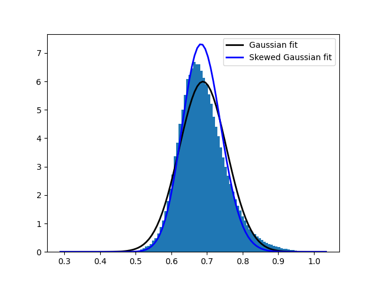
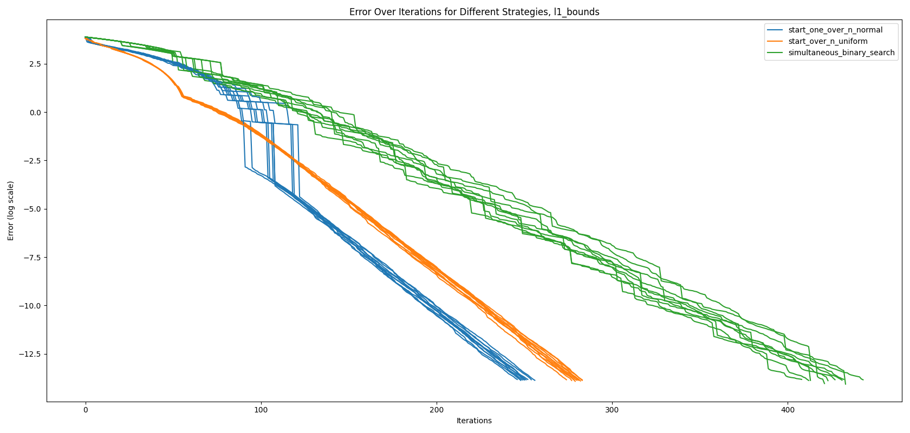
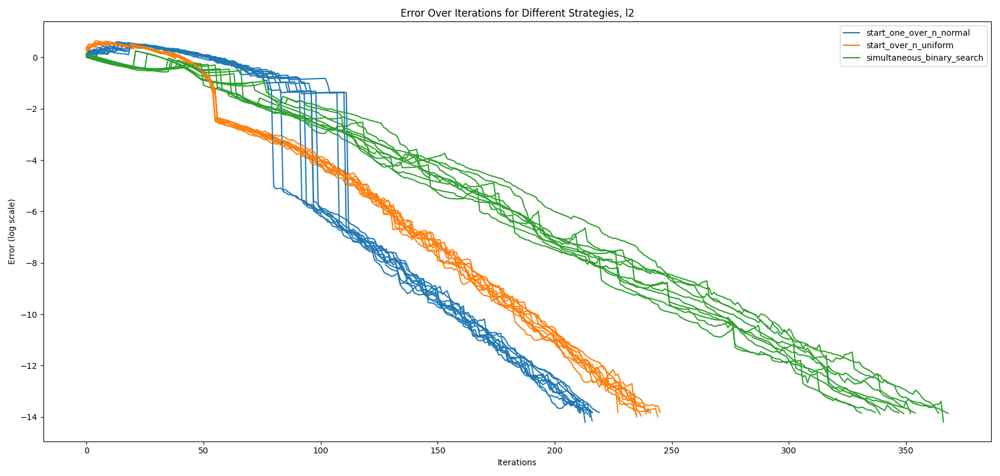
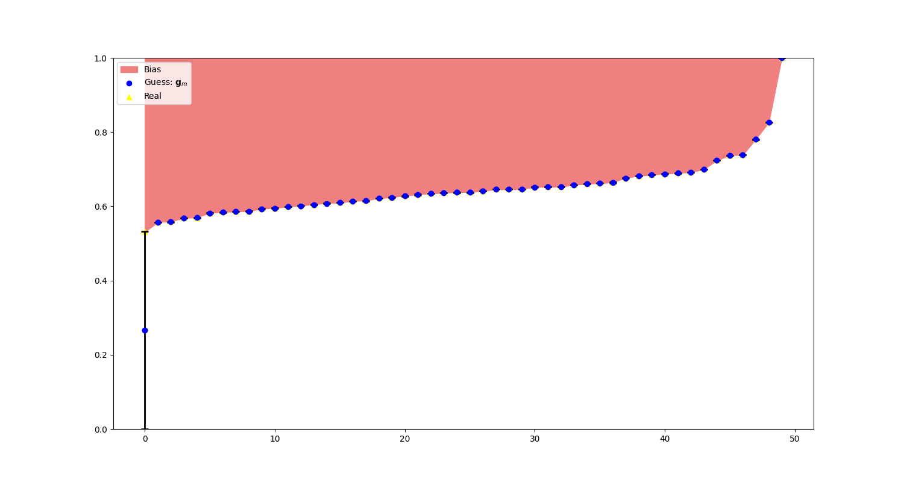
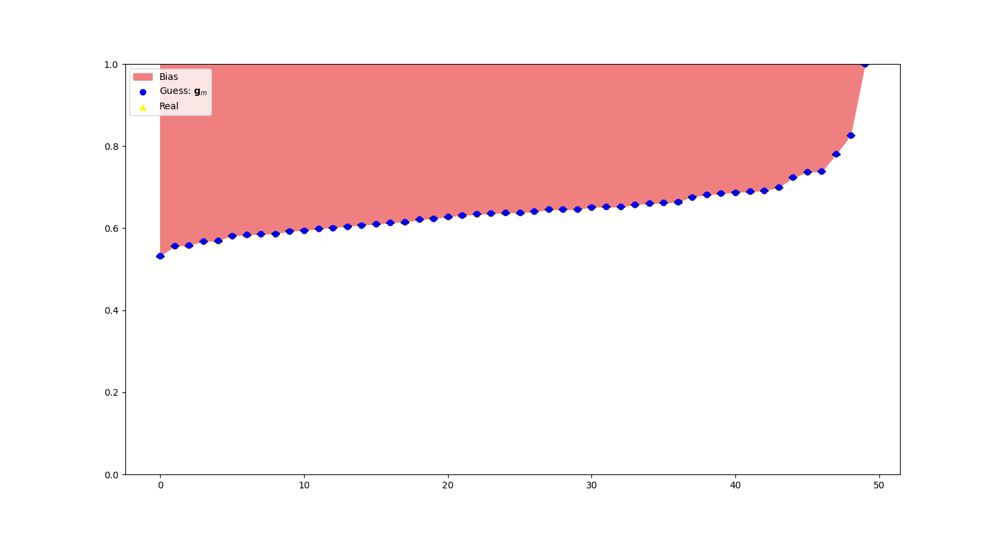
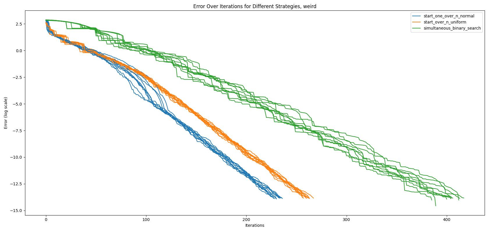
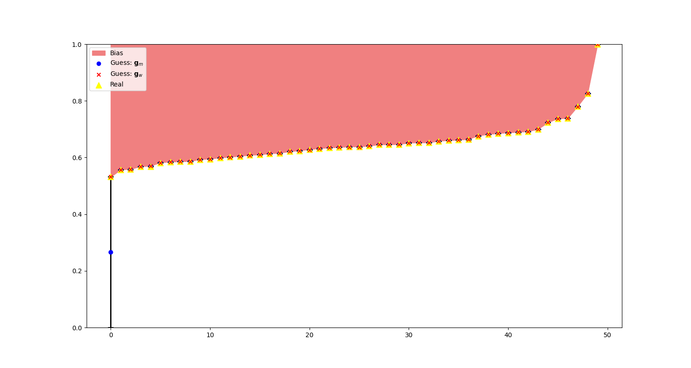
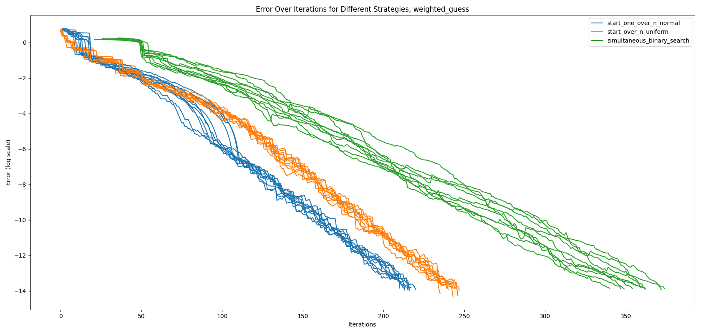

## Introduction

The current best-performing large language models are typically closed proprietary systems accessible only through APIs. Companies provide minimal information about their models' size, architecture, training data, or training processes ([OpenAI+24](#openai2024), [Google+23](#palm2023)). However, recent research by [CPD+24](#carlini2024) and [FRS+24](#finlayson2024) has shown that it is possible to extract detailed information about these closed models by exploiting certain functionalities offered by APIs from companies like OpenAI and Google. These studies have successfully extracted the exact model dimensionality, specifically, the hidden dimension and the final layer weights, known as the unembedding matrix.

To extract the model dimensionality and steal the unembedding layer, the attacks rely on collecting a large number of full logit distributions. A _full logit distribution_ refers to the output vector produced by a neural network before the application of the softmax function. This vector contains the raw, unnormalized scores (logits) for each class in a classification task. In the context of large language models, the full logit distribution represents the scores assigned to each token in the model's vocabulary for a given input sequence. The full logit distribution is not by default visible to users; after all, language models usually just output the next token.

All attacks so far work by first getting the full next-token logit distribution from the model, and then use the logits to infer facts about the weights. In this post, we improve the first part: extracting the full logit distribution.

**Related Work.** The attacks formulated in related works ([CPD+24](#carlini2024), [FRS+24](#finlayson2024)) relied on _two_ API functionalities provided by the companies to steal a large number of full next-token logit distributions:

1. **Access to Log Probabilities.** The access to the log probabilities of some of the most likely tokens. This feature enables users to obtain detailed information about the model's predictions for the next token in a sequence.

2. **Biasing Tokens Using a Bias Map.** The ability to add a bias term to each logit before applying the softmax function. This bias map feature allows API users to influence the model's output by either censoring certain tokens or promoting others [^1].

[^1]: Why is this parameter even present? OpenAI introduced the logit_bias map to give companies and users of their API greater control over the model's output. For example, the [guidance library](https://github.com/guidance-ai/guidance){:target="\_blank"} uses the bias map to restrict generation to a limited set of options. This is particularly useful in cases where developers need to steer the behavior of the large language models in a concrete direction, preventing the model from generating undesired outputs.

The most efficient attacks, as detailed in [CPD+24](#carlini2024) and [FRS+24](#finlayson2024), employ a combination of the aforementioned features. By biasing all tokens to appear among the most likely tokens and subsequently collecting their log probabilities, attackers can reverse engineer these probabilities back to logits. However, following the publication of these attacks, both Google and OpenAI have removed the feature that allows viewing of biased log probabilities. Consequently, this work focuses exclusively on algorithms that leverage the bias map feature to extract the next-token logit distribution.

## General Algorithm Formulation

We consider a typical transformer architecture for a large language model. Let $\mathcal{P(X)}$ represent the space of all probability distributions over the vocabulary $\mathcal{X}$. Transformer models take $N$ tokens as input from a vocabulary $\mathcal{X}$ of size $v$ and output a probability distribution for the next token $\mathbf{q} \in \mathcal{P(X)}$, i.e., models of the form $f: \mathcal{X}^N \mapsto \mathcal{P(X)}$. The probability distribution, conditioned on the previous $N$ tokens in the sequence, is computed by applying a softmax $\mathbb{R}^v \mapsto \mathcal{P(X)}$ to the full logit distribution vector $\mathbb{R}^{v}$ of the last token, $\mathbf{z}$.

Logits are the raw, unnormalized scores output by a neural network's final layer before applying the softmax function. The softmax function is defined as:

$$
\text{softmax}(\mathbf{z}) = \left[ \frac{e^{z_1}}{\sum_{i=1}^v e^{z_i}}, \ldots, \frac{e^{z_v}}{\sum_{i=1}^v e^{z_i}} \right]
$$

We assume access to the model API provided by the owners of the model, such as OpenAI or Google, and we explore the class of attacks based on the following two assumptions.

**Access to Bias Map.** We assume that it is possible to set a bias term $b_i$ for any token $\mathcal{X}_i$ in the vocabulary $\mathcal{X}$, where $b_i$ can range from $-B$ to $B$. The number of tokens that can have a bias term set is limited to a constant $N_b \leq v$. We use vector notation $\mathbf{b} \in \mathbb{R}^v$, meaning the length of the bias vector is $v$. In cases where $N_b < v$, for all tokens that are not biased, we assume $b_i = 0$. The bias vector $\mathbf{b}$ is added to the logit vector $\mathbf{z}$ before applying the softmax function.

**Access to Top Token.** We constrain the information received from the API to only the token with the highest probability after applying the softmax function.

Define prompt $p$ as a unique sequence of $N$ tokens and let $g: \mathcal{X}^N \rightarrow \mathbb{R}^v$ be a function that outputs the logit vector $\mathbf{z}$ for the next token in the sequence. The Oracle $\mathcal{O}$ (API) is a black-box function that, given a prompt $p$ and a bias vector $\mathbf{b}$, returns the token with the highest probability.

$$
\mathcal{O}(p, b) \gets \text{ArgMax} \left(\text{softmax} \left( g(p) + \mathbf{b} \right) \right)
$$

Additionally, we assume that $\text{ArgMax}(\mathbf{v})$ returns the index of the coordinate with the largest value in some vector $\mathbf{v} \in \mathbb{R}^v$. In case two or more values are equal and the maximum, the $\text{ArgMax}$ function will randomly select one of the indices corresponding to the maximum values. We refer to the indices of the vectors and tokens interchangeably.

**Definition 1:** We say that a token is **sampled** if it is the token returned by the oracle's ArgMax function.

Note that we can ensure the token with the highest logit value, which corresponds to the highest probability token, is consistently sampled by setting the temperature parameter to 0 or by configuring the top-k parameter to 1.

### Logit normalization

To facilitate the implementation of the algorithm and ensure consistent scaling of the logit values, we will normalize the logit vectors to the interval $[0, 1]$. This normalization helps in simplifying the bias adjustments and maintaining a uniform scale for comparison across different logits.

Given a logit vector $\mathbf{z}$, we normalize it using the following procedure. Calculate the minimum and maximum values of the logit vector $\mathbf{z}$:

$$
z_{\delta} = \min(\mathbf{z}), \quad z_{\Delta} = \max(\mathbf{z})
$$

Normalize each component $z_i$ of the logit vector $\mathbf{z}$ to the interval $[0, 1]$ using the formula:

$$
\hat{z}_i = \frac{z_i - z_{\delta}}{z_{\Delta} - z_{\delta}}
$$

where $\hat{z}_i$ is the normalized logit value.

In a realistic setting, we can assume knowledge of the width of the interval on which logits lie. Observations from API providers suggest that it suffices to take $B$ as the width of this interval. Furthermore, to facilitate shifting the interval and simplify notation, we assume knowledge of the maximum logit value $z_\Delta$.[^2]

Henceforth, we assume all logit vectors $\mathbf{z}$ are normalized to the interval $[0, 1]$.

[^2]: Note that OpenAI provides access to the log probabilities of the top-5 most likely tokens, which are not affected by the bias term after the introduction of the attacks. Consequently, we can infer the initial top-5 token logits, allowing us to determine the maximum value.

### Algorithm Framework

We will consider algorithms that modify the bias of multiple tokens simultaneously. Specifically, at each step, we will adjust the biases of all $N_b$ tokens. In scenarios where $N_b < v$, it is necessary to select subsets of tokens and repeat the procedure $\frac{v}{N_b}$ times. Prior to initiating the algorithm, we perform an initial query to the API without applying any bias map to identify the top token and set its index to 0 i.e. top token is $z_0$.
We now introduce a general algorithm framework that is used to iteratively narrow down the possible values of $\mathbf{z}$, using lower bound vector $\mathbf{l} \in \mathbb{R}^{N_b}$ and upper bound vector $\mathbf{h} \in \mathbb{R}^{N_b}$, and give a concrete description of its implementation. The goal of all instances of this algorithm discussed in the following sections will be to come up with the function $\mathbf{f}(\mathbf{l}, \mathbf{h}, r)$, which sets all $N_b$ bias terms at each step of the algorithm. The following algorithm framework is a vectorized and generalized version of the algorithm discussed in [CPD+24](#carlini2024).

<strong>Algorithm 1:</strong> Learning logit differences with multi-token calls (Vectorized)

<ol>
<li>$\mathbf{l} \gets \mathbf{0}, \mathbf{h} \gets \mathbf{1}$</li>
<li>$\mathcal{C} = \{\mathbf{x} : z_0 - z_i \leq 1, \forall i \}$</li>
<li>$r \gets 1$</li>
<li><strong>while</strong> stop_condition($\mathbf{l}, \mathbf{h}, r$) is false <strong>do</strong></li>
<li style="text-indent: 1em;">$\mathbf{b} \gets \mathbf{f}(\mathbf{l}, \mathbf{h}, r)$</li>
<li style="text-indent: 1em;">$k \gets \mathcal{O}(p, \mathbf{b})$</li>
<li style="text-indent: 1em;">
$\mathcal{C} \gets \mathcal{C} \cap \{\mathbf{x} : z_k + b_k \geq z_j + b_j, \forall j \neq k\}$
</li>
<li style="text-indent: 1em;">$\mathbf{l} \gets \mathbf{x}_{\text{min}}$</li>
<li style="text-indent: 1em;">$\mathbf{h} \gets \mathbf{x}_{\text{max}}$</li>
<li style="text-indent: 1em;">$r \gets r + 1$</li>
<li><strong>end while</strong></li>
<li><strong>return</strong> $\mathbf{l}, \mathbf{h}$</li>
</ol>

At each step of Algorithm 1, we provide a specific bias vector $\mathbf{b} = \mathbf{f}(\mathbf{l}, \mathbf{h}, r)$ and sample a top token from the oracle, denoted as $k$. By the definition of $\mathcal{O}$, this results in $N_b - 1$ inequalities of the form $z_k + b_k \geq z_j + b_j$ for all $j \neq k$. We can rewrite these inequalities as $-z_k + z_j \leq b_k - b_j$. Therefore, at step $n$, we can represent the coefficients of logits as $A_n \in \mathbb{R}^{N_b - 1 \times N_b}$ and the resulting bound as $\mathbf{b}_n \in \mathbb{R}^{N_b - 1}$. Aggregating results after $n$ steps, we let:

$$
A = \begin{pmatrix}
A_1 \\
A_2 \\
\vdots \\
A_n
\end{pmatrix}, \quad
b = \begin{pmatrix}
b_1 \\
b_2 \\
\vdots \\
b_n
\end{pmatrix}
$$

So, the polytope $\mathcal{C}$ defined by this system of linear inequalities can be expressed as:

$$\mathcal{C} = \{ \mathbf{x} \in \mathbb{R}^{N_b} \mid A \mathbf{x} \leq \mathbf{b} \}$$

After updating the system for our polytope at each step with new information, we are interested in finding $$\mathbf{x}_{\text{min}}$$ and $$\mathbf{x}_{\text{max}}$$, where $$\mathbf{x}_{\text{min}}$$ is the solution of the polytope where each component of the vector $\mathbf{x}$ is minimal and $$\mathbf{x}_{\text{max}}$$ is the solution where each component is maximal. Formally, this can be defined as:

$$
\mathbf{x}_{\text{min}} = \left( \min_{\mathbf{x} \in \mathcal{C}} x_1, \min_{\mathbf{x} \in \mathcal{C}} x_2, \ldots, \min_{\mathbf{x} \in \mathcal{C}} x_n \right)
$$

and

$$
\mathbf{x}_{\text{max}} = \left( \max_{\mathbf{x} \in \mathcal{C}} x_1, \max_{\mathbf{x} \in \mathcal{C}} x_2, \ldots, \max_{\mathbf{x} \in \mathcal{C}} x_n \right)
$$

We can compute both $$\mathbf{x}_{min}$$ and $$\mathbf{x}_{max}$$ by considering the linear programming problem of finding the shortest path on a weighted graph [CPD+24](#carlini2024).

Generally, we consider two different stop conditions for the attacker's querying process:

**Fixed Budget Condition**: When the attacker has a budget of $T$ requests for each batch of $N_b$ tokens, the querying process stops after $T$ rounds. Formally, this stop condition can be defined as:

   $$
   \text{stop_condition}(\mathbf{l}, \mathbf{h}, r) =
   \begin{cases}
   \text{True} & \text{if } r \geq T, \\
   \text{False} & \text{otherwise}.
   \end{cases}
   $$

**Precision Condition**: When the attacker aims to attain a certain precision $\epsilon$ of the result and disregards the budget, the querying process stops when the largest interval so far is less than $\epsilon$. Formally, this stop condition can be defined as:

   $$
   \text{stop_condition}(\mathbf{l}, \mathbf{h}, r) =
   \begin{cases}
   \text{True} & \text{if } \| \mathbf{h} - \mathbf{l} \|_\infty < \epsilon, \\
   \text{False} & \text{otherwise}.
   \end{cases}
   $$

### StartOverN With Uniform Prior

We start by assuming uniform prior over the interval $[l_i, h_i]$ for each logit. A simple approach is to bias logits such that the probability of sampling token 0 (i.e. the maximum token) is $1/n$. This approach, introduced briefly in [CPD+24](#carlini2024), has been the state-of-the-art method prior to the work presented in this paper. We formalize this approach and provide a derivation for a solution of the biasing term.

**Theorem 1:** Given independent and identically distributed (i.i.d.) random variables $P_1, P_2, \ldots, P_{n-1}$ from a uniform distribution on an interval between $l_i$ and $h_i$, and constants $b_1, b_2, \ldots, b_{n-1}$, the StartOverN algorithm aims to find $b_i$ such that:

$$
P \left( \max(P_1 + b_1, P_2 + b_2, \ldots, P_{n-1} + b_{n-1}) \leq 1 \right) = \frac{1}{n}
$$

A solution to this problem is given by:

$$
b_i = 1 - l_i - \left(\frac{1}{n}\right)^{\frac{1}{n-1}} (h_i - l_i)
$$

  
Click to expand the proof

  We need

$$
\begin{align*}
P \left( \max(P_1 + b_1, \ldots, P_{n-1} + b_{n-1}) \leq 1 \right) &= \frac{1}{n} \\
P(P_1 + b_1 \leq 1) \cdot \ldots \cdot P(P_{n-1} + b_{n-1} \leq 1) &= \frac{1}{n} \\
P(P_1 \leq 1 - b_1) \cdot \ldots \cdot P(P_{n-1} \leq 1 - b_{n-1}) &= \frac{1}{n} \\
\prod_{i=1}^{n-1} \frac{1 - b_i - l_i}{h_i - l_i} &= \frac{1}{n}
\end{align*}
$$

This is satisfied if $\forall i$:

$$
\begin{align*}
\frac{1 - b_i - l_i}{h_i - l_i} &= \left(\frac{1}{n}\right)^{\frac{1}{n-1}} \\
1 - b_i - l_i &= \left(\frac{1}{n}\right)^{\frac{1}{n-1}} (h_i - l_i) \\
b_i &= 1 - l_i - \left(\frac{1}{n}\right)^{\frac{1}{n-1}} (h_i - l_i)
\end{align*}
$$

Hence, $b_i = 1 - l_i - \left(\frac{1}{n}\right)^{\frac{1}{n-1}} (h_i - l_i)$ is a solution.

In the vector notation of the biasing function we would therefore write:

$$
\mathbf{f}(\mathbf{l}, \mathbf{h}, r) = 1 - \mathbf{l} - \left(\frac{1}{n}\right)^\frac{1}{n-1}(\mathbf{h} - \mathbf{l})
$$

For the readers coming from [CPD+24](#carlini2024) we note that the solution can be rewritten using an equivalent scaling term:

$$
\left(\frac{1}{n}\right)^\frac{1}{n-1} = \exp\left(\frac{-\log(n)}{n - 1}\right)
$$

### Finding parameters for normal distribution

In the previous derivation, we assumed a uniform distribution for all logits in the full output token vector, as proposed in [CPD+24](#carlini2024). However, this assumption may not accurately reflect the true distribution of logits in large language models. To investigate this, we collected and analyzed logit distributions from several models, including LLaMA-7B, GPT-2, and Pythia.

For LLaMA-7B, which we'll focus on in this example, we gathered 52 logit distributions using single character prompts (A-Z and a-z). After normalizing each distribution with an assumed width of 40, we flattened the 52 distributions into a single vector. Figure 1 shows the histogram of this logit distribution using 100 bins in the interval $[0, 1]$.

As evident from Figure 1, the logit distribution for LLaMA-7B deviates significantly from a uniform distribution. Instead, it appears to follow a normal distribution more closely. Similar patterns were observed in the other models we analyzed, though with varying parameters. This observation suggests that we can improve upon the algorithm in [CPD+24](#carlini2024) by incorporating a more accurate distributional assumption.

For our numerical experiments with LLaMA-7B, we fitted a normal distribution to the data, obtaining parameters $\mu = 0.688$ and $\sigma = 0.066$. These parameters will be used in the following sections to develop an improved algorithm that leverages this more accurate representation of the logit distribution. While our algorithm assumes knowledge of $\mu$ and $\sigma$, in practice, these parameters could be estimated by transferring knowledge from smaller models or by analyzing a small sample of collected logit distributions.

### StartOverN With Normal Distribution Prior

Now we can formalize an algorithm using the normal distribution prior. We consider each logit as a random variable drawn from a normal distribution using the parameters $\mu$ and $\sigma^2$, which we have derived in previous section. At each step of the algorithm we bound the logit $z_i$ using $l_i$ and $h_i$ meaning the logits are actually drawn from a truncated normal distribution over the interval $[l_i, h_i]$.

Formally, we note let $P_i \sim N(\mu, \sigma^2)$ be truncated such that $l_i \leq P_i \leq h_i$ and $0 \leq l_i \leq h_i \leq 1$, where $\Phi$ is the CDF of $N(\mu, \sigma^2)$.

Then, the CDF of $P_i$ is given by:

$$
\Phi_{P_i}(x) = P( P_i \leq x ) = \frac{\Phi(x) - \Phi(l_i)}{\Phi(h_i) - \Phi(l_i)}
$$

**Theorem 2:** Given independent and identically distributed (i.i.d.) random variables $P_1, P_2, \ldots, P_{n-1}$ from a truncated normal distribution with truncation points $l_i$ and $h_i$, and constants $b_1, b_2, \ldots, b_{n-1}$, the StartOverN algorithm aims to find $b_i$ such that:

$$
P \left( \max(P_1 + b_1, P_2 + b_2, \ldots, P_{n-1} + b_{n-1}) \leq 1 \right) = \frac{1}{n}
$$

A solution to this problem is given by:

$$
b_i = 1 - \Phi^{-1} \left( \left(\frac{1}{n}\right)^{\frac{1}{n-1}} (\Phi(h_i) - \Phi(l_i)) + \Phi(l_i) \right)
$$

  
Click to expand the proof

  We need

  

  $$
  \begin{align*}
  P \left( \max(P_1 + b_1, \ldots, P_{n-1} + b_{n-1}) \leq 1 \right) &= \frac{1}{n} \\
  P(P_1 + b_1 \leq 1) \cdot \ldots \cdot P(P_{n-1} + b_{n-1} \leq 1) &= \frac{1}{n} \\
  P(P_1 \leq 1 - b_1) \cdot \ldots \cdot P(P_{n-1} \leq 1 - b_{n-1}) &= \frac{1}{n} \\
  \prod_{i=1}^{n-1} \frac{\Phi(1 - b_i) - \Phi(l_i)}{\Phi(h_i) - \Phi(l_i)} &= \frac{1}{n} \\
  \end{align*}
  $$
  

This is satisfied if $\forall i$:

  

  $$
  \begin{align*}
  \frac{\Phi(1 - b_i) - \Phi(l_i)}{\Phi(h_i) - \Phi(l_i)} &= \left(\frac{1}{n}\right)^{\frac{1}{n-1}} \\
  \Phi(1 - b_i) - \Phi(l_i) &= \left(\frac{1}{n}\right)^{\frac{1}{n-1}} (\Phi(h_i) - \Phi(l_i)) \\
  \Phi(1 - b_i) &= \left(\frac{1}{n}\right)^{\frac{1}{n-1}} (\Phi(h_i) - \Phi(l_i)) + \Phi(l_i) \\
  1 - b_i &= \Phi^{-1} \left( \left(\frac{1}{n}\right)^{\frac{1}{n-1}} (\Phi(h_i) - \Phi(l_i)) + \Phi(l_i) \right) \\
  b_i &= 1 - \Phi^{-1} \left( \left(\frac{1}{n}\right)^{\frac{1}{n-1}} (\Phi(h_i) - \Phi(l_i)) + \Phi(l_i) \right)
  \end{align*}
  $$
  

Hence,

  
 
  $b_i = 1 - \Phi^{-1} \left( \left(\frac{1}{n}\right)^{\frac{1}{n-1}} (\Phi(h_i) - \Phi(l_i)) + \Phi(l_i) \right)$ 
  

  is a solution.

We have derived the bias term in similar fashion to the uniform prior. Again we write the vector notation of the biasing function as:

$$
\mathbf{f}(\mathbf{l}, \mathbf{h}, r) =  1 - \Phi^{-1} \left( \left(\frac{1}{n}\right)^{\frac{1}{n-1}} (\Phi(\mathbf{h}) - \Phi(\mathbf{l})) + \Phi(\mathbf{l}) \right).
$$

The generalized form of the function for any distribution truncated on the interval $[a, b]$, where the CDF is defined as:

$$
F_{[a,b]}(x) = \frac{F(x) - F(a)}{F(b) - F(a)}, \quad \text{for} \; a \leq x \leq b.
$$

This can be analogously formulated as:

$$
\mathbf{f}(\mathbf{l}, \mathbf{h}, r) = 1 - F^{-1} \left( \left(\frac{1}{n}\right)^{\frac{1}{n-1}} (F(\mathbf{h}) - F(\mathbf{l})) + F(\mathbf{l}) \right)
$$

This result can be useful when considering different distributional assumptions for the logit

## Numerical analysis

Notice that at each iteration of Algorithm 1, we update the lower bound $\mathbf{l}$ and upper bound $\mathbf{h}$. Upon reaching a specified stopping condition, we return both bounds as the best estimates for all logits. This approach implies that, up to this point, we have not made any concrete _guess_ about the actual values of the logits. While a straightforward solution might involve taking the midpoint, i.e., $\frac{\mathbf{h} + \mathbf{l}}{2}$, as demonstrated in this section, this strategy may be suboptimal in scenarios where the attacker is constrained by a finite query budget $T$.

**Definition:** Let $\mathbf{l}, \mathbf{h} \in \mathbb{R}^{N_b}$ be vectors representing the lower and upper bounds, respectively. A **guess** is a function $g: \mathbb{R}^{N_b} \times \mathbb{R}^{N_b} \to \mathbb{R}^{N_b}$ that maps $\mathbf{l}$ and $\mathbf{h}$ to a vector $\mathbf{g} \in \mathbb{R}^{N_b}$ such that $\mathbf{l} \leq \mathbf{g} \leq \mathbf{h}$ element-wise.

We have already discussed _errors_ that were defined as the $l_1-norm$ and $l_{\infty}-norm$ of the bounds, that is $$\| \mathbf{h} - \mathbf{l} \|_1$$ and $$\| \mathbf{h} - \mathbf{l} \|_{\infty}$$ respectively. For testing purposes of how our algorithms are performing we can analogously define an error in terms of the true value of the logits $z$ and our $guess$, similarly we consider $$\| \mathbf{z} - \mathbf{g} \|_2$$.

In all results we also report on the performance of the simple _simultaneous-binary-search_ algorithm, which is defined by the biasing function $\mathbf{f}(\mathbf{l}, \mathbf{h}, r) = 1 - \frac{\mathbf{l} + \mathbf{h}}{2}$.

Using $$\| \mathbf{h} - \mathbf{l} \|_1$$ and $$\| \mathbf{z} - \mathbf{g}_m \|_2$$, we evaluate the performance of the _simultaneous-binary-search_, _start-over-n-with-uniform-prior_, and _start-over-n-with-normal-distribution_ algorithms on the 10 logit distributions we have collected from LLaMa-7b, as shown in [Figure 1](#figure-1). We assess the algorithms using the mid guess, defined as $\mathbf{g}_m = \frac{\mathbf{h} + \mathbf{l}}{2}$, and plot the logarithm of the error. To illustrate an interesting phenomenon, we draw error lines for 10 different logit vectors for each algorithm, instead of reporting confidence intervals.

<em>Figure 1(a): Visualization of algorithms performance - $\| \mathbf{z} - \mathbf{g}_m \|_2$, $N_b = 50$</em>

<em>Figure 1(b): Visualization of algorithms performance - $\| \mathbf{h} - \mathbf{l} \|_1$, $N_b = 50$</em>

As observed in [Figure 1](#figure-1), our new algorithm, _start-over-n-with-normal-distribution_, outperforms both the state-of-the-art _start-over-n-with-uniform-prior_ and _simultaneous-binary-search_. Interestingly, the algorithm exhibits a 'jump' around the 100th iteration mark. To better understand this behavior, we inspect the bounds at the steps immediately before and after the jump, as shown in [Figure 2](#figure-2).

<em>Figure 2(a): Example of logits at iteration 98 with blue $\mathbf{g}_m$</em>

<em>Figure 2(b): Example of logits at iteration 99 with blue $\mathbf{g}_m$</em>

As seen in the graphs in [Figure 2](#figure-2), only the upper bound of the last logit, $$z_{last}$$, was updated before the jump. Referencing [Observation 1](https://drive.google.com/file/d/1sdGkHmTKEQiOgZv3idgbY7PBaK1zVvhX/view?usp=drive_link), if a logit $$z_i$$ has never been sampled, we can only update its upper bound $$h_i$$. This explains the observed jump. The algorithm spends the first 98 iterations before sampling the last token, $$z_{last}$$. Once the last token is sampled, it quickly establishes a precise lower bound, $$l_i$$. This behavior is analogous to the perfect algorithm described in [Section 3.4](https://drive.google.com/file/d/1sdGkHmTKEQiOgZv3idgbY7PBaK1zVvhX/view?usp=drive_link), where at step $$N_b - 1$$, the lower bounds $$l_i$$ of all logits are close to the true values $$z_i$$, and at step $$N_b$$, all upper bounds $$h_i$$ are updated simultaneously.

This implies that for $$\| \mathbf{h} - \mathbf{l} \|_1$$, the error at iteration 98 is dominated by the difference $$h_{last} - l_{last}$$, and for $$\| \mathbf{z} - \mathbf{g}_m\|_2$$, by the difference $$z_{last} - g_{m_{last}}$$. Hence, we observe a dramatic change in the error graph.

One way to correct for jumps is to define a new _weird_ error metric that uses a combination of bounds and the actual values.

$$
weird(\mathbf{l}, \mathbf{h}, \mathbf{z}) = \sum_{i=1}^{N_b} \min(h_i - z_i, z_i - l_i)
$$

<em>Figure 3: $weird(\mathbf{l}, \mathbf{h}, \mathbf{z})$, $N_b = 50$</em>

As shown in [Figure 3](#figure-3), using the newly defined error metric, the jumps have disappeared. While this error metric addresses the problem, it has a drawback: if the attacker has a low budget of queries $$T$$, our new attack would underperform until about the 100th iteration.

A slightly better approach would be to adjust our guess by leveraging our understanding of the reason for the jump. One general solution is to weight how far the lower bound $$l_i$$ is from its initial value 0, and how far the upper bound $$h_i$$ is from its initial value 1. This ensures that we are closer to the respective bound in proportion to how far we are from the initial value. We achieve this with the following definition.

$$
\mathbf{m} = \frac{\mathbf{h} + \mathbf{l}}{2}
$$

$$
\mathbf{r} = \frac{\mathbf{h} - \mathbf{l}}{2}
$$

$$
\mathbf{g}_w = \mathbf{m} + \left(\frac{1 - \mathbf{h}}{\mathbf{l} + (1 - \mathbf{h})}\right) \mathbf{r} - \left(\frac{\mathbf{l}}{\mathbf{l} + (1 - \mathbf{h})}\right) \mathbf{r}
$$

We start by centering our guess at the middle value of the bounds, and then weighting how far we have moved from the initial value: $$1 - \mathbf{h}$$ for the upper bound and $$\mathbf{l}$$ for the lower bound, divided by the total amount we have moved from the initial values, $$\mathbf{l} + (1 - \mathbf{h})$$. Using these weights, we scale the radius $$\mathbf{r}$$ of our interval.

When we examine the state of our _start-over-n-with-normal-prior_ algorithm before sampling the last token, i.e., before the jump, we observe that the weighted guess is correctly aligned with its true value. This is because, for tokens that have not been sampled yet, the weighted error equals the upper bound $$h_i$$, which means $$\mathbf{g}_w = \mathbf{h}$$ for all unsampled tokens.

<em>Figure 4: Example of logits at iteration 98 with blue $\mathbf{g}_m$ and red $\mathbf{g}_w$</em>

Finally, we run the algorithms using the weighted guess $$\mathbf{g}_w$$ with $$\| \mathbf{z} - \mathbf{g}_w \|_2$$ to inspect its stability in [Figure 5](#figure-5). Using the weighted guess we are now on par with _start-over-n-with-uniform-prior_ during the first 100 iterations.

<em>Figure 5: Visualization of algorithms performance - $\| \mathbf{z} - \mathbf{g}_w \|_2$, $N_b = 50$</em>

We hypothesize that error jumps are an essential characteristic of highly performant algorithms, as they indicate precise boundary estimation.

## Performance

We evaluate the performance of various algorithms designed to extract logit distributions from large language models. We compare the algorithms based on the number of queries required to achieve a specified precision and report on the queries per logit metric. We measure their performance using the l2-norm of the difference between the true logit vector $$\mathbf{z}$$ and the weighted guess $$\mathbf{g}_w$$ by $$\| \mathbf{z} - \mathbf{g}_w \|_2$$.

<table class="responsive-table">
  <thead>
    <tr>
      <th>Name</th>
      <th>Bias Function f(l,h)</th>
      <th>Queries per logit</th>
    </tr>
  </thead>
  <tbody>
    <tr>
      <td data-label="Name">Simultaneous Binary Search</td>
      <td data-label="Bias Function">
        

          $$1 - \frac{l+h}{2}$$
        

      </td>
      <td data-label="Queries per logit">3.12</td>
    </tr>
    <tr>
      <td data-label="Name">Start Over N with Uniform Prior</td>
      <td data-label="Bias Function">
        

          $$1 - l - \left(\frac{1}{n}\right)^{\frac{1}{n-1}}(h - l)$$
        

      </td>
      <td data-label="Queries per logit">2.42</td>
    </tr>
     <tr class="bold-row">
      <td data-label="Name">Start Over N with Normal Prior</td>
      <td data-label="Bias Function">
        

          $$1 - \Phi^{-1}\left(\left(\frac{1}{n}\right)^{\frac{1}{n-1}}(\Phi(h) - \Phi(l)) + \Phi(l)\right)$$
        

      </td>
      <td data-label="Queries per logit">1.98</td>
    </tr>
  </tbody>
</table>
Table 1: Comparison of Algorithms with Precision $10^{-6}$ and $\mathbf{g}_w$

## References

[CPD+24]
Carlini, N., Paleka, D., Dvijotham, K. D., Steinke, T., Hayase, J., Cooper, A. F., Lee, K., Jagielski, M., Nasr, M., Conmy, A., Wallace, E., Rolnick, D., & Tramèr, F. (2024, March). Stealing Part of a Production Language Model [arXiv:2403.06634]. [http://arxiv.org/abs/2403.06634](http://arxiv.org/abs/2403.06634)

[FRS+24]
Finlayson, M., Ren, X., & Swayamdipta, S. (2024, March). Logits of API-Protected LLMs Leak Proprietary Information [arXiv:2403.09539]. [https://doi.org/10.48550/arXiv.2403.09539](https://doi.org/10.48550/arXiv.2403.09539)

[OpenAI+24]
OpenAI, Achiam, J., Adler, S., Agarwal, S., Ahmad, L., Akkaya, I., Aleman, F. L., Almeida, D., Altenschmidt, J., Altman, S., Anadkat, S., Avila, R., Babuschkin, I., Balaji, S., Balcom, V., Baltescu, P., Bao, H., Bavarian, M., Belgum, J., ... Zoph, B. (2024, March). GPT-4 Technical Report [arXiv:2303.08774]. [https://doi.org/10.48550/arXiv.2303.08774](https://doi.org/10.48550/arXiv.2303.08774)

[Google+23]
Anil, R., Dai, A. M., Firat, O., Johnson, M., Lepikhin, D., Passos, A., Shakeri, S., Taropa, E., Bailey, P., Chen, Z., Chu, E., Clark, J. H., Shafey, L. E., Huang, Y., Meier-Hellstern, K., Mishra, G., Moreira, E., Omernick, M., Robinson, K., ... Wu, Y. (2023, September). PaLM 2 Technical Report [arXiv:2305.10403]. [https://doi.org/10.48550/arXiv.2305.10403](https://doi.org/10.48550/arXiv.2305.10403)
